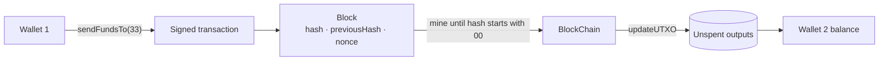

<div align="center">

# kCoin — A Blockchain in Kotlin

A compact, readable blockchain and cryptocurrency implementation: proof of work, wallets,
signed transactions and a UTXO ledger,.


</div>

## Table of contents

- [Features](#features)
- [How it works](#how-it-works)
- [Run it](#run-it)
- [Project structure](#project-structure)
- [Limitations](#limitations)
- [License](#license)

## Features

- **Blocks** linked by SHA-256 hashes, each holding its transactions
- **Proof of work**: blocks are mined by incrementing a nonce until the hash starts with
  two zeros (difficulty 2)
- **Wallets** that generate RSA key pairs
- **Signed transactions**: SHA256withRSA signatures that can be verified
- **UTXO model**: unspent outputs are tracked as blocks are mined, and a wallet's balance is
  the sum of the outputs it owns
- **Chain validation** that re-checks every hash, link and proof of work

## How it works



`Main.kt` walks through a complete scenario: it creates two wallets, funds the first with a
genesis transaction, mines a block, sends 33 coins to the second wallet and prints each
balance along the way.

## Run it

**Prerequisites:** a recent JDK and the Kotlin compiler (`kotlinc`), or IntelliJ IDEA.

```bash
kotlinc src/Main.kt src/kcoin/*.kt -include-runtime -d kcoin.jar
java -jar kcoin.jar
```

Or open the project in IntelliJ IDEA and run `Main.kt`.

## Project structure

```
src/
├── Main.kt              Demo scenario with two wallets
└── kcoin/
    ├── Block.kt         Block data and hash calculation
    ├── BlockChain.kt    Chain, mining, validation and UTXO updates
    ├── Transaction.kt   Transactions, outputs, signing and verification
    ├── Wallet.kt        Key generation, balance and sending funds
    └── Utils.kt         SHA-256 hashing, signing and key encoding helpers
```

## Limitations

This is a teaching implementation. It has a single in-memory chain, no networking or
consensus between nodes, a fixed low difficulty and no persistence, so it must not be used
to hold real value.

## Roadmap, contributing and citation

- **Roadmap:** [ROADMAP.md](ROADMAP.md) lists planned work and directions for the project.
- **Contributing:** see [CONTRIBUTING.md](CONTRIBUTING.md) and the
  [Code of Conduct](CODE_OF_CONDUCT.md). Issues labelled `good first issue` are a friendly start.
- **Citation:** [CITATION.cff](CITATION.cff) powers GitHub's "Cite this repository" button.

## License

Released under the [MIT License](LICENSE).

---

Built by **Swagata Banerjee** · [GitHub](https://github.com/gitswagata1)
